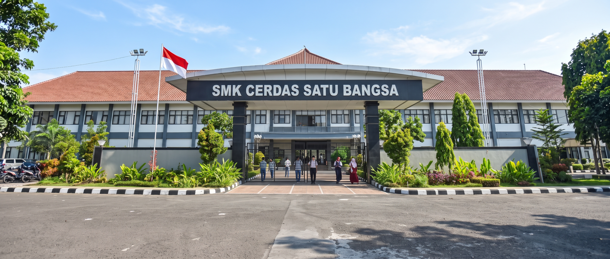
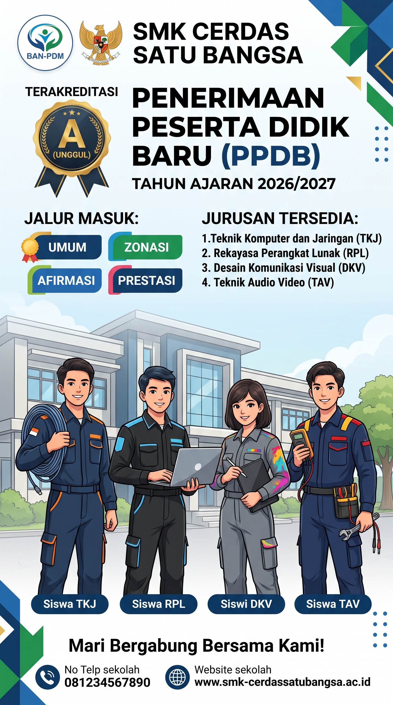
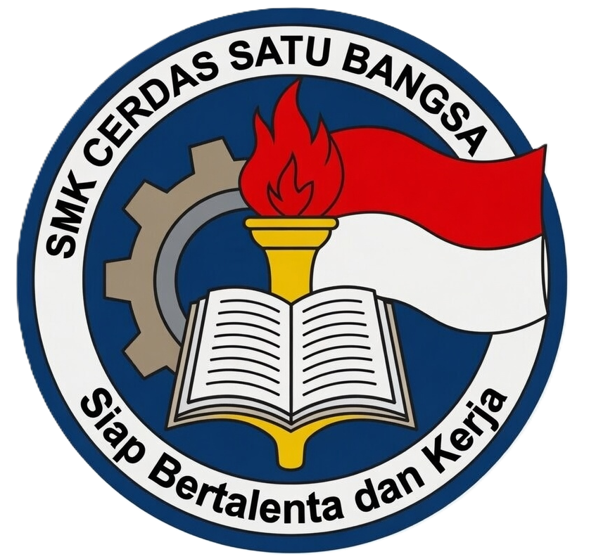

# 🏫 Portal Website Resmi SMK Cerdas Satu Bangsa

[](https://php.net)
[](https://getbootstrap.com)
[](https://mysql.com)
[](https://developer.mozilla.org)
[](https://w3.org)

---

## 1. 📌 Judul Proyek & Deskripsi Singkat

**Portal Web Resmi SMK Cerdas Satu Bangsa** (*"Siap Bertalenta dan Kerja"*) adalah aplikasi web portal profil sekolah kejuruan modern berbasis **PHP Native** yang dirancang untuk menyampaikan identitas kelembagaan, keunggulan 4 jurusan vokasi, berita dan dokumentasi kegiatan, serta memfasilitasi Penerimaan Peserta Didik Baru (**PPDB Online**) secara interaktif, bersih, cepat, dan responsif di seluruh perangkat (Desktop, Tablet, dan Smartphone).

---

## 2. 📸 Tangkapan Layar / GIF Demo

> *Aset gambar di bawah ini menggunakan file visual nyata yang tersedia di dalam folder `assets/img/`:*

| 🏛️ Gedung & Kampus Sekolah | 🏆 Highlight Siswa Aktif |
| :---: | :---: |
|  |  |

| 🏷️ Brosur Resmi PPDB 2026/2027 | 🔖 Identitas & Logo Sekolah |
| :---: | :---: |
|  |  |

*(Untuk menambahkan rekaman animasi berformat `.gif` atau tangkapan layar tampilan navigasi mobile menu 3D, Anda dapat menambahkan file tangkapan layar ke folder `assets/img/` dan menautkannya di sini).*

---

## 3. ✨ Fitur Utama (Features)

1. **Beranda Interaktif & Modern (`index.php`)**:
   - **Hero Section**: Banner visual dengan tipografi bold modern dan call-to-action dinamis.
   - **Komponen "Highlight Sekolah Kami"**: 6 kartu pencapaian berbasis gambar penuh (*media-driven full image cards*) dengan efek rotasi otomatis (*auto-slideshow*) setiap 3 detik pada fasilitas dan prestasi, penghitung angka statistik (*count-up counter*), serta tombol navigasi panah samping yang otomatis menyembunyikan diri (*auto-hide*) di batas awal/akhir slider.
   - **Kartu Jurusan Modern**: 4 kartu jurusan dengan floating badge logo, ringkasan prospek kerja, dan tombol eksplorasi detail.
   - **Berita Terkini**: Menampilkan 3 artikel paling baru dengan penanda visual khusus *"Terbaru"*.
   - **Pop-up Brosur PPDB Interaktif**: Modal otomatis di beranda yang menampilkan brosur PPDB tahun ajaran baru, dapat ditutup melalui tombol silang, klik di luar area modal, maupun tombol `Esc`.

2. **Profil Sekolah Komprehensif (`profil/`)**:
   - `sejarah.php`: Kronik berdirinya sekolah dan tonggak pencapaian.
   - `visi-misi.php`: Visi, misi utama, dan nilai-nilai dasar pendidikan karakter.
   - `struktur.php`: Struktur organisasi kepemimpinan kepala sekolah, wakil, dan staf dewan guru.
   - `fasilitas.php`: Katalog ruang praktik, sarana olahraga, perpustakaan, dan laboratorium.
   - `sertifikasi.php`: Status akreditasi A (Unggul), lisensi Lembaga Sertifikasi Profesi (LSP/BNSP), serta kemitraan industri.

3. **Eksplorasi 4 Program Keahlian Unggulan (`program/`)**:
   - `tkj.php`: **Teknik Komputer & Jaringan** (Infrastruktur jaringan, server, fiber optic & cybersecurity).
   - `rpl.php`: **Rekayasa Perangkat Lunak** (Pemrograman web, mobile apps, database & cloud).
   - `tav.php`: **Teknik Audio Video** (Elektronika sistem audio visual & IoT smart home).
   - `dkv.php`: **Desain Komunikasi Visual** (Videografi, animasi, ilustrasi digital & desain grafis).
   - Dilengkapi silabus mata pelajaran Kurikulum Merdeka per tingkatan kelas (X, XI, XII) dan prospek karir lulusan.

4. **Sistem Informasi & Pendaftaran PPDB Online (`ppdb/`)**:
   - `informasi.php`: Syarat umum/khusus, jadwal gelombang seleksi, rincian biaya, dan kontak panitia.
   - `formulir.php`: Formulir pendaftaran calon siswa baru interaktif multi-kolom yang rapi dan responsif.
   - `pengumuman.php`: Informasi pengumuman seleksi berkas dan hasil kelulusan.

5. **Portal Berita & Publikasi Sekolah (`berita.php` & `berita-detail.php`)**:
   - Pengelolaan artikel terpusat dan modular via `data/berita-data.php`.
   - Fitur pencarian, filter kategori pengumuman/kegiatan, sistem pagination interaktif, dan rekomendasi artikel terkait.

6. **Galeri Dokumentasi Sekolah (`galeri.php`)**:
   - Grid galeri foto dokumentasi kegiatan pembelajaran, perlombaan, dan fasilitas dengan filter kategori.

7. **Layanan Kontak Terintegrasi Database (`kontak.php`)**:
   - Form kirim pesan/pertanyaan pengunjung yang langsung tersimpan otomatis ke database MySQL (tabel `kontak_pesan`).
   - Informasi alamat resmi, email, nomor hotline WhatsApp, serta peta lokasi interaktif.

8. **Tracer Study Alumni & Bursa Kerja Khusus (`alumni/`)**:
   - `alumni.php`: Pendataan sebaran karir alumni di industri maupun perguruan tinggi.
   - `karir.php`: Informasi lowongan pekerjaan dari mitra industri dan magang kerja.

9. **Navigasi Side Panel Menu Modern & Ringkas (`partials/navbar.php`)**:
   - Menggantikan menu dropdown standar dengan **Side Panel Slide-In** dari kanan.
   - Desain terang (*clean & light theme*) dengan kartu 3D halus, badge ikon 30px pastel yang proporsional, serta indikator toggle **`+`** dan **`−`** yang sejajar presisi di sisi kanan.

---

## 4. 🛠️ Prasyarat & Teknologi (Tech Stack & Prerequisites)

### Prasyarat Lingkungan (Prerequisites)
* **Web Server**: Apache atau Nginx (disarankan menggunakan **Laragon**, **XAMPP**, atau bawaan PHP Server).
* **PHP**: Versi `>= 8.0` (Disarankan PHP 8.1, 8.2, atau 8.3).
* **Database**: MySQL versi `>= 5.7` atau MariaDB `>= 10.4`.
* **Web Browser**: Google Chrome, Mozilla Firefox, Microsoft Edge, atau Safari versi modern.

### Teknologi yang Digunakan (Tech Stack)
* **Backend Scripting**: PHP Native (Object-oriented & Procedural bersih tanpa ketergantungan Composer).
* **Database Driver**: PHP `mysqli` (*prepared statements & safe escaping*).
* **Frontend Framework**: [Bootstrap 5.3](https://getbootstrap.com/) (Grid System & Utilities).
* **Icons**: [FontAwesome 6.4 Free CDN](https://fontawesome.com/).
* **Typography**: Google Fonts (*Poppins* untuk heading modern & *Inter* untuk teks isi yang nyaman dibaca).
* **Animasi & Interaktivitas**: 
  - [AOS - Animate On Scroll](https://michalsnik.github.io/aos/) untuk efek scroll halus.
  - Vanilla JavaScript (ES6+) untuk carousel tracker, auto-slideshow timer, dan modal handler.
  - CSS3 Modern (Flexbox, CSS Grid, 3D Transform, Glassmorphism, Transition).

---

## 5. 🚀 Panduan Instalasi & Memulai (Installation & Getting Started)

### Cara 1: Menggunakan Laragon / XAMPP (Direkomendasikan)
1. **Salin Folder Proyek**:
   Letakkan folder `website-utama` di dalam direktori web server lokal Anda:
   - Laragon: `C:\laragon\www\sekolah-management\website-utama\`
   - XAMPP: `C:\xampp\htdocs\sekolah-management\website-utama\`
2. **Siapkan Database MySQL**:
   - Buka **phpMyAdmin** atau HeidiSQL.
   - Buat database baru bernama `sekolah_db`.
   - Import file `sekolah_db.sql` (tersedia di root `sekolah-management/` atau import tabel yang dibutuhkan).
3. **Buka di Browser**:
   Akses melalui browser Anda:
   ```text
   http://localhost/sekolah-management/website-utama/
   ```

---

### Cara 2: Menggunakan PHP Built-in Server (Tanpa XAMPP)
Jika PHP sudah terpasang di komputer Anda:
1. Buka terminal atau Command Prompt di dalam folder `website-utama`:
   ```bash
   cd "C:\Users\mjuff\Documents\Project ngoding\sekolah-management\website-utama"
   ```
2. Jalankan server lokal:
   ```bash
   php -S localhost:8080
   ```
3. Buka browser dan akses alamat:
   ```text
   http://localhost:8080/
   ```

---

### Cara 3: Deployment ke Vercel (Static CDN)
Website ini telah dikonfigurasi untuk dapat di-deploy secara instan di **Vercel** sebagai Static Site berkecepatan tinggi:
1. Setiap kali Anda selesai mengedit file `.php` secara lokal, jalankan script generator:
   ```bash
   php build.php
   ```
2. Commit dan push ke repository GitHub:
   ```bash
   git add -A
   git commit -m "update konten"
   git push origin main
   ```
3. Vercel akan otomatis mendeteksi pembaruan dan menayangkannya langsung di domain Anda (misal: `https://smk-cerdassatubangsa.vercel.app/`).

---

## 6. 📖 Cara Penggunaan & Konfigurasi (Usage Guide)

### A. Konfigurasi Database & Domain (`koneksi.php`)
Konfigurasi koneksi MySQL dan pendeteksian URL otomatis berada di file `koneksi.php`:
```php
// Pengaturan Koneksi Database
$host_db = "localhost";
$user_db = "root";
$pass_db = "";
$name_db = "sekolah_db";
```
> *Catatan: Jika website ini di-upload ke layanan hosting online, cukup sesuaikan `$user_db`, `$pass_db`, dan `$name_db` dengan data database cPanel/Hosting Anda.*

### B. Cara Menambah / Mengedit Berita & Artikel
Data master berita dikelola secara cepat dan modular di `data/berita-data.php`:
1. Buka file [`data/berita-data.php`](data/berita-data.php).
2. Tambahkan data berita baru di urutan **paling atas** array `$semua_berita` agar otomatis tampil sebagai berita terbaru di beranda:
   ```php
   [
       'id'        => 8,
       'judul'     => 'Judul Berita Terbaru Sekolah',
       'slug'      => 'judul-berita-terbaru-sekolah',
       'ringkasan' => 'Ringkasan singkat berita...',
       'tanggal'   => 'Senin, 20 Oktober 2026',
       'kategori'  => 'Prestasi',
       'gambar'    => BASE_URL . 'assets/img/berita-artikel/berita-8.jpg',
       'penulis'   => 'Humas Sekolah',
       'isi'       => '<p>Isi lengkap berita di sini...</p>',
   ],
   ```
3. Simpan file gambar artikel ke folder `assets/img/berita-artikel/`.

### C. Alur Pengiriman Pesan Kontak
Pesan yang dikirim pengunjung melalui form `kontak.php` otomatis divalidasi dan disimpan ke tabel MySQL `kontak_pesan`:
```sql
CREATE TABLE IF NOT EXISTS `kontak_pesan` (
  `id` INT AUTO_INCREMENT PRIMARY KEY,
  `nama` VARCHAR(150) NOT NULL,
  `email` VARCHAR(150) NOT NULL,
  `subjek` VARCHAR(200) NOT NULL,
  `pesan` TEXT NOT NULL,
  `created_at` TIMESTAMP DEFAULT CURRENT_TIMESTAMP
);
```

---

## 7. 🤝 Panduan Kontribusi (Contributing)

Kontribusi untuk perbaikan bug antarmuka, optimasi performa, atau penambahan fitur halaman sekolah sangat dipersilakan:
1. Buat branch kerja baru untuk perbaikan:
   ```bash
   git checkout -b fix/nama-perbaikan
   ```
2. Pastikan penulisan kode HTML/CSS/PHP mengikuti standar yang rapi, semantik, serta mempertahankan kompatibilitas tampilan responsif (*mobile-first*).
3. Commit dan push perubahan Anda:
   ```bash
   git commit -m "style: Penyesuaian layout responsive kartu program keahlian"
   git push origin fix/nama-perbaikan
   ```
4. Buat **Pull Request (PR)** dengan deskripsi perubahan yang jelas.

---

## 8. 📄 Lisensi (License)

Proyek website ini dilisensikan di bawah lisensi terbuka **[MIT License](https://opensource.org/licenses/MIT)**. Anda bebas mengembangkan, memodifikasi, dan mengadaptasi website ini untuk keperluan institusi pendidikan, sekolah kejuruan lain, atau proyek portofolio pribadi.

---

## 9. 📞 Kontak & Penghargaan (Credits & Contact)

* **Institusi Sekolah**: SMK Cerdas Satu Bangsa
* **Slogan**: *"Siap Bertalenta dan Kerja"*
* **Email Resmi**: `info@smkcerdasbangsa.sch.id`
* **Penghargaan (Credits)**:
  - Tim IT & Hubungan Masyarakat SMK Cerdas Satu Bangsa.
  - Komunitas Open Source penyedia pustaka [Bootstrap](https://getbootstrap.com/), [FontAwesome](https://fontawesome.com/), dan [AOS](https://michalsnik.github.io/aos/).
  - Google Fonts (*Poppins* & *Inter* typography).
